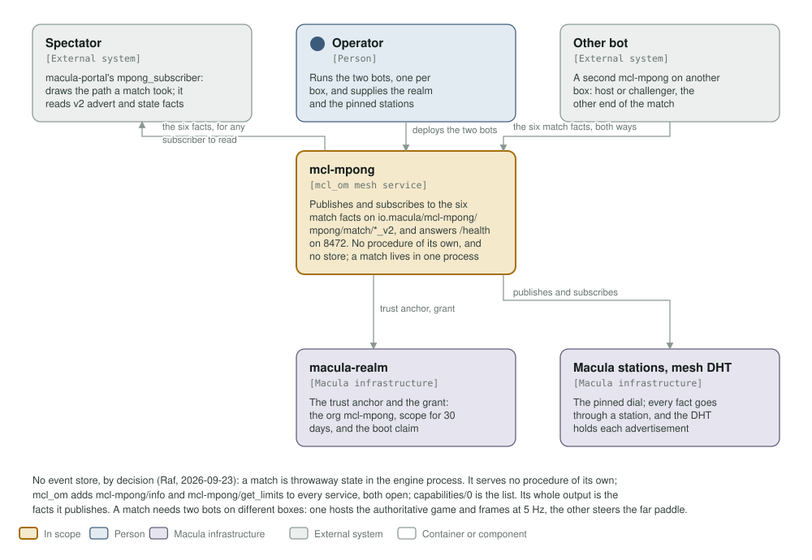
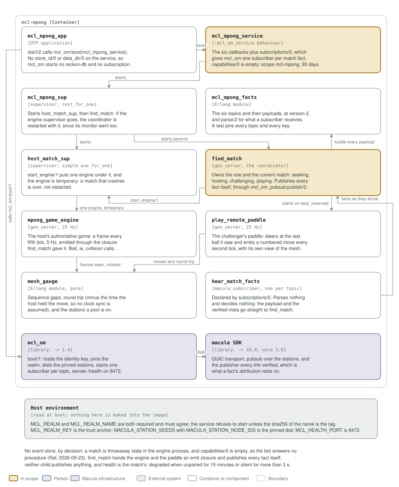

# mcl-mpong architecture: C4 model

*This exists so a reader can see what mcl-mpong talks to, and what it is made of,
without reading it.*

**Status: built and tested on wire 1.0.** mcl_om `~> 1.4` and macula `~> 16.0`; a `v*`
tag builds and signs the image. macula-fleet carries a two-bot definition, one bot per
box, so every match crosses stations. The bot answers no procedure of its own and keeps no
store.

## Level 1: system context

| Element | Kind | Role |
| --- | --- | --- |
| mcl-mpong | In scope | Publishes and subscribes to the six match facts on `io.macula/mcl-mpong/mpong/match/*_v2`, and answers `/health` on 8472. No procedures of its own and no store: a match lives in one process |
| Spectator | External system | macula-portal's `mpong_subscriber`, which draws the path a match took. It still reads the old topics and is to be repointed at these six |
| Operator | Person | Runs the two bots, one per box, and supplies the realm and the pinned stations |
| Other bot | External system | A second mcl-mpong on another box: host or challenger, the other end of the match |
| macula-realm | Macula infrastructure | The trust anchor and the grant: the org `mcl-mpong`, scope for 30 days, and the boot claim its operator sees |
| Macula stations, mesh DHT | Macula infrastructure | The pinned dial. Every fact goes through a station, and the DHT holds each advertisement |

A match needs two bots on different boxes: one hosts the authoritative game at 25 Hz
and publishes a frame at 5 Hz, the other steers the far paddle and reports what it
saw. There is no event store, by decision (Raf, 2026-09-23): a match is throwaway
state in the engine process, so the bot owns no reckon-db and no read model.

## Level 2: containers and components

| Component | Technology | Responsibility |
| --- | --- | --- |
| `mcl_mpong_app` | OTP application | `start/2` calls `mcl_om:boot(mcl_mpong_service)`. The service exports no `store_id/0` or `data_dir/0`, so mcl_om starts no reckon-db and no subscription |
| `mcl_mpong_service` | the `mcl_om_service` behaviour | The six callbacks plus `subscriptions/0`, which gives mcl_om one subscriber per match fact. `capabilities/0` is empty; scope `mcl-mpong`, 30 days, no actions and no resources. `start/1` refuses a realm whose tag does not match `MCL_REALM_NAME` |
| `mcl_mpong_sup` | supervisor, `rest_for_one` | Starts `host_match_sup`, then `find_match`. If the engine supervisor goes, the coordinator is restarted with it, since its monitor on a hosted engine went too |
| `mcl_mpong_facts` | Erlang module | The six topics and their payloads at version 2, and `parse/2` for what a subscriber receives. A test pins every topic and every key |
| `host_match_sup` | supervisor, `simple_one_for_one` | `start_engine/1` puts one engine under it. The engine is `temporary`: a match that crashes is over, not restarted |
| `find_match` | `gen_server`, the coordinator | Owns the role and the current match: seeking, hosting, challenging, playing. Publishes every fact itself, through `mcl_om_pubsub:publish/2` on a `mcl_mpong_facts` topic, and hands the engine and the paddle an emit closure |
| `mpong_game_engine` | `gen_server`, 25 Hz | The host's authoritative game: a frame every fifth tick, 5 Hz, emitted through the closure. Calls `mpong_ball`, `mpong_ai`, `mpong_collision` and `mpong_obstacles` |
| `play_remote_paddle` | `gen_server`, 25 Hz | The challenger's paddle: steers at the last ball it saw and emits a numbered move every second tick, carrying its own view of the mesh |
| `mesh_gauge` | Erlang module, pure | Sequence gaps, round trip (minus the time the host held the move, so no clock sync is assumed), and the stations a pool is on |
| `hear_match_facts` | `macula_subscriber`, one per topic | Declared by `subscriptions/0`. Parses nothing and decides nothing: the payload and the meta macula verified go straight to `find_match` |
| `mcl_om` | library, `~> 1.4` | `boot/1`: loads the identity key, joins the realm, dials the pinned stations, starts one subscriber per topic, serves `/health` on 8472 |
| macula SDK | library, `~> 16.0`, wire 1.0 | QUIC transport, pubsub over the stations, and the verified publisher every fact's attribution rests on |
| Host environment | read at boot | `MCL_REALM` and `MCL_REALM_NAME` (required, and they must agree), `MCL_REALM_KEY`, `MACULA_STATION_SEEDS`, `MACULA_STATION_NODE_IDS`, `MCL_HEALTH_PORT`, `MCL_NODE_NAME`, `MCL_NODE_HOST`, `MCL_COOKIE` |

`/health` is the match's health, not the mesh's: `down` when the coordinator is not
answering, `degraded` when the bot has had no opponent for more than 15 minutes or the
other end of a match has been silent for more than 3 seconds, `ok` otherwise, including
while seeking. `config/sys.config.src` fixes the org `mcl-mpong` and the realm, and
pins `pq_hybrid` as the crypto profile, without which no station accepts the handshake.
`deploy/docker-compose.yml` mounts one named volume, `mcl-mpong-secrets`, for the node
identity key: a second bot on the same host must give its copy a different volume name,
container name and health port, or the two share one identity.

**Where the station list comes from.** It is not in `config/sys.config.src`: `mcl_om` reads `MACULA_STATION_SEEDS` and `MACULA_STATION_NODE_IDS` from the environment at boot, paired index for index, so this repository pins no station and the list may be any length.

## Drawing them

`assets/c4-context.svg` and `assets/c4-components.svg` are generated by
`architecture/c4_diagrams.py` (`python3 architecture/c4_diagrams.py`), from the code
and never from this page: the callbacks and `subscriptions/0` in
`apps/mcl_mpong/src/mcl_mpong_service.erl`, the launch tree in `mcl_mpong_sup.erl` and
`find_match.erl`, the six topics in `mcl_mpong_facts.erl`, the deps in `rebar.config`,
the realm and org settings in `config/sys.config.src`, and the health port in the
`Containerfile`.

Two rules for the files themselves, so they render everywhere they are read (GitHub,
an IDE, `rsvg-convert`): self-contained SVG, and literal colours in plain classes
plus a `prefers-color-scheme` dark block, never CSS custom properties, which
`rsvg-convert` renders black.

The check that keeps them here is the `c4-model` job in
`.github/workflows/c4-model.yml`. It is red until both files exist and are shown,
and it stays red if either one goes missing.
